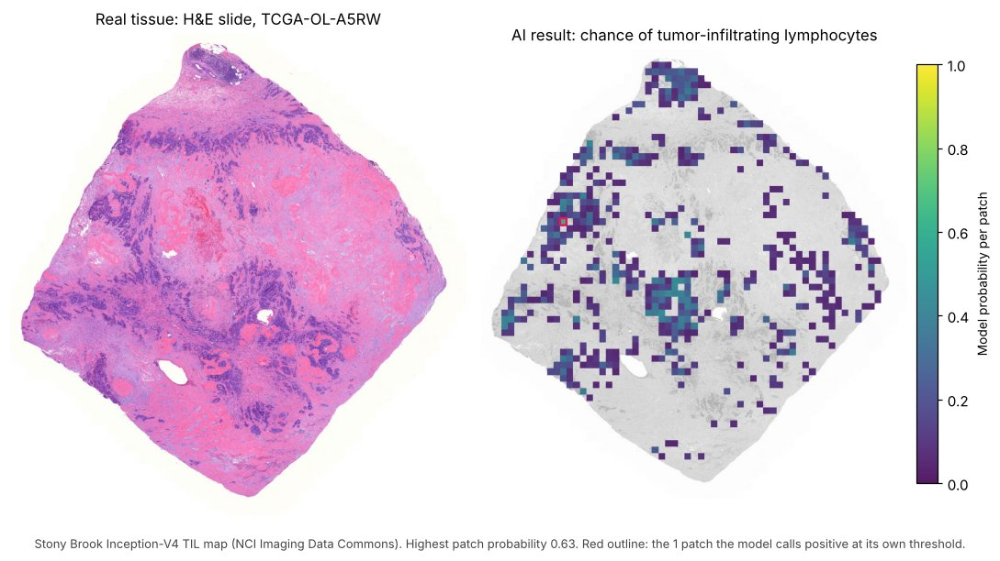

# OncoSys Cancer AI Lab: Healthcare AI Hackathon



**Left:** a real H&E slide from TCGA (patient TCGA-OL-A5RW). **Right:** a published AI model's estimate of where tumor-infiltrating lymphocytes are. Its highest patch probability is 0.63, and at its own threshold it calls just one patch positive. **Is that result right, and how would anyone check?** That's what you'll build tools for.

<p>
<a href="data/README.md"></a>
<a href="products/README.md"></a>
<a href="https://colab.research.google.com/github/disleveK/oncosys-hackathon-challenge/blob/main/starter/tcga_starter.ipynb"></a>
</p>

You don’t need a GitHub account to open the starter. You’ll need to sign in to Google to run it in Colab. No Google account? [Run it on your computer](#run-it-on-your-computer).

- **Explore the data:** seven data packs (tumor molecular data, tissue images, CT scans, cell lines, trial records) plus a 30-minute warm-up. The menu shows included starters, source downloads and viewer links.
- **Pick a mission:** six featured products and optional custom builds, across two tracks.
- **Run the starter:** in 15 minutes, download real tumor data, see how each join shrinks the cohort, and open a slide in your browser.

## Pick a user, build one workflow
| Track | What it does | Featured products |
|---|---|---|
| **Cohort Firewall** | Catches what could make a result unreliable | [Cohort Control Tower](products/cohort-control-tower.md) · [Cohort Studio](products/cohort-studio.md) |
| **Evidence Navigator** | Helps someone investigate a result and decide what to do | [Multimodal Case Room](products/multimodal-case-room.md) · [Evidence Copilot](products/evidence-copilot.md) · [Research Claim Auditor](products/research-claim-auditor.md) · [Repair Review Desk](products/repair-review-desk.md) |

Build a web app, an AI agent, a visual workflow, or a tool that plugs into a notebook. You can also combine two products or [pitch your own](products/README.md#pitch-your-own-lighter-support).

**The bar:** a judge can use your workflow without you narrating, and it shows **one result they can verify** and **one limitation they can inspect.**

**The finale:** a Cohort Control Tower catches a silent change in a new data release, and a different team's Repair Review Desk receives the findings and makes the review decision, live, through the [shared format](format/README.md).

## The week
| When | What |
|---|---|
| **Wed, Nov 11, 7 PM ET** | Virtual kickoff. Form your team, pick a product, run the starter. [Slides (PDF)](kickoff/Cancer_AI_Lab_Kickoff.pdf) · [recording](https://the-open-accelerator.com/hackathon/upcoming/OncoSysHack/) |
| **Thu, Nov 12, 1:30 PM ET** | Team registration closes ([form](https://red.ht/toa-oncosys-team-matching), teams of 3–5). Organizers then post **team pairs** in Discord. |
| **Thu, Nov 12 · Checkpoint 1** | Post **one working result** in Discord: a screenshot or short clip of your tool producing something real from the data. |
| **Fri, Nov 13 · Checkpoint 2** | **Swap repos with your paired team.** Each team clones the other's repo into a fresh folder, follows its README alone, and posts in Discord what worked and what broke. |
| **Sat, Nov 14** | In person at the Cabral Center. You open your [sealed envelope](envelopes/README.md) at the start of your Q&A. Code freeze **2:15 PM**; demos 2:30–4:00 PM; awards 4:30 PM. |

Checkpoints aren't part of the rubric, but Checkpoint 2 is the best way to find out, before judges do, whether your project runs on someone else's machine.

## The data packs
| Pack | One record is… | Status |
|---|---|---|
| [TCGA breast cancer](data/tcga-brca/README.md) *(core)* | A tumor sample with clinical, survival, mutation, copy number, RNA and protein data, plus slide links | Ready |
| [Pathology: PathMNIST](data/pathmnist/README.md) | A labelled colorectal tissue patch | Ready |
| [Molecular + imaging: CPTAC](data/cptac/README.md) | A lung, colon or kidney cancer case | Ready: protein, slides and CT links |
| [Imaging: LIDC-IDRI](data/lidc-idri/README.md) | A chest CT with radiologists' nodule marks | Ready |
| [Prediction: DepMap](data/depmap/README.md) | A cancer cell line | Ready |
| [Trial records: ClinicalTrials.gov](data/clinical-trials/README.md) | A dated trial record + fictional cases | Ready for practice |
| [Advanced: CAMELYON17](data/camelyon17/README.md) | A lymph-node slide from one of 5 hospitals | Ready (source-linked) |

**Only join records where a documented match exists.** Tissue patches, cell lines, tumor samples and CT scans describe different things. See [the joining rule](data/README.md#the-joining-rule).

## What's in this repo
| Path | What it is |
|---|---|
| `starter/tcga_starter.ipynb` | The 15-minute starter |
| `products/` | Six featured product briefs, practice inputs, and pitch-your-own ideas |
| `data/` | Seven data packs: each with a README, sources and checksums, fetch script, and manifests |
| `kickoff/` | Kickoff slides (PDF) |
| `assets/` | The challenge page image |
| `envelopes/` | Sealed envelopes: the unseen inputs for Saturday, plus a practice envelope ([how they work](envelopes/README.md)) |
| `format/` | Shared findings format v0.2, validator and reference output |
| `warmup/wisconsin/` | Optional 30-minute warm-up on a small dataset |
| [`RULES.md`](RULES.md) · [`DATA_LICENSES.md`](DATA_LICENSES.md) | What's allowed, and how to credit the data |
| [`SUBMISSION_CHECKLIST.md`](SUBMISSION_CHECKLIST.md) | What to check before the code freeze |

## Run it on your computer
The local Jupyter route needs no Google account, and no GitHub account is needed to clone this public repo.

```bash
git clone https://github.com/disleveK/oncosys-hackathon-challenge.git
```
```bash
cd oncosys-hackathon-challenge
```
```bash
pip install -r requirements.txt
```
```bash
python data/tcga-brca/fetch.py
```
```bash
jupyter notebook starter/tcga_starter.ipynb
```

## Recommended tools
Use any stack. Start with the smallest toolset that lets someone else rerun your work. No paid account, hosted app, or AI coding assistant is required.

| Task | Optional tools | What to practice |
|---|---|---|
| Read and check the data | [pandas](https://pandas.pydata.org/), [Polars](https://docs.pola.rs/), or [DuckDB](https://duckdb.org/). For repeatable checks, try [Pandera](https://pandera.readthedocs.io/) or [Great Expectations](https://docs.greatexpectations.io/). [ydata-profiling](https://docs.profiling.ydata.ai/) can help with initial exploration. | Keep sample and patient IDs separate. Record the release, checksums, checks run, and affected samples. Treat a profile report as a starting point, not a verdict. |
| Compare figures | A notebook or SQL is enough. | Compare figures with their denominators. Test whether reasonable choices about which samples to include change the conclusion. |
| Work with slides | NCI Imaging Data Commons viewer links in `slide_manifest.csv`; [`idc-index`](https://pypi.org/project/idc-index/) to download | Distinguish diagnostic from frozen slides. Link a slide to a case only when its barcode matches. |
| Build a reviewer interface | [Streamlit](https://docs.streamlit.io/get-started) or [Gradio](https://www.gradio.app/docs). Try [axe-core](https://github.com/dequelabs/axe-core) or [Lighthouse](https://developer.chrome.com/docs/lighthouse/) for accessibility checks. | Make it possible to trace a headline number to its evidence and reach a decision without the presenter. Test keyboard navigation and whether labels make sense without color. |
| Use AI responsibly | Any LLM or a local model. Users supply their own key; never commit one. | Let the AI run real queries rather than answer from memory. Show its sources. Make it say when the data can't answer. |
| Document provenance | The [shared format](format/README.md), a Markdown evidence log, or [W3C PROV](https://www.w3.org/TR/prov-overview/) as background | For each claim, record the release, samples, calculation, limitation, and who should review it. |
| Check for secrets | [Gitleaks](https://github.com/gitleaks/gitleaks), manually or in pre-commit | Before submitting, check for credentials, tokens, private URLs and restricted files. |

## Source and citation
TCGA data from the UCSC Xena TCGA hub and NCI Imaging Data Commons; full credits in [`DATA_LICENSES.md`](DATA_LICENSES.md). The data is de-identified but patient-derived: research use only, no re-identification, no clinical claims.
